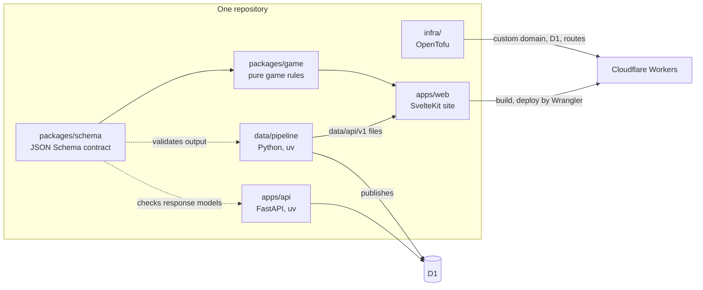
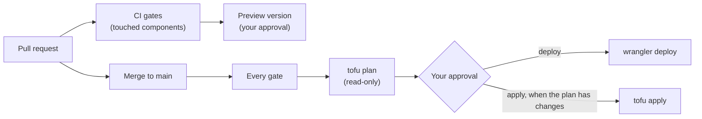
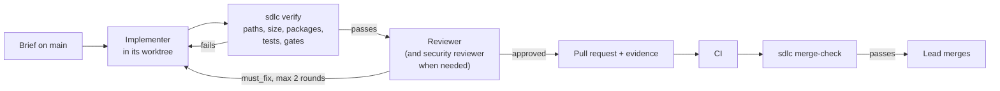

# Engineering tooling and design choices: why, what, how and the trade-offs

> Status: In review
> Created: 2026-11-21T20:55:39Z
> Last reviewed: 2026-11-21T20:55:39Z
> Next review: Not scheduled

## Review guide

Decision requested: confirm that this paper explains the stack and the
delivery tooling correctly, and name any choice you want to revisit.

Check these points:

- [ ] The principles in [Summary](#summary) are the ones you want every
      choice judged by.
- [ ] Each trade-off table states the cost you accepted, not only the gain.
- [ ] The open questions at the end are the right ones.

Respond with `approve`, `approve with follow-up: <action>` or
`request changes: <specific issue>`.

## Summary

Soccer Cards is a static card game for children. It's built as one
repository with four parts: a SvelteKit site, the game rules and the data
contract as TypeScript packages, and a Python data pipeline. It runs on
Cloudflare Workers, with OpenTofu for infrastructure, and is delivered by
agents under a kit of deterministic checks.

Five principles decide most choices:

1. **Child-safe by construction.** No accounts, no analytics, no request to
   another host, and nothing a visitor can write
   ([ADR 0003](../decisions/0003-data-photos-and-child-privacy.md)).
2. **Free forever.** Free tiers only (your words on 2026-11-21: "yes its
   free and only my kid is using it").
3. **Static first.** Build ahead of time and serve files. A server is added
   only where files can't do the job
   ([ADR 0001](../decisions/0001-stack-and-repository-layout.md) D7,
   [ADR 0008](../decisions/0008-player-api-and-database.md)).
4. **Tools from their maintainers.** Use the maintained tool and its own
   skills over a custom one (ADR 0004 D13).
5. **A program checks what it can.** Rules live in code and tests, not only
   in prompts ([ADR 0004](../decisions/0004-ai-delivery-workflow-and-enforcement.md)).

An arrow between packages means "may import". A package imports only from
those to its left, and a lint rule enforces it (ADR 0001 D1).

## The web app

| Choice                                                                   | Why                                                                                                                                        | Cost accepted                                                             |
| ------------------------------------------------------------------------ | ------------------------------------------------------------------------------------------------------------------------------------------ | ------------------------------------------------------------------------- |
| SvelteKit 3, Svelte 5, prerendered with `adapter-static`                 | Small runtime for an animated phone game. Prerendering needs no server                                                                     | SvelteKit 3 is a few months old, so expect fixes in minor releases        |
| TypeScript 6 with `strict`                                               | Type errors fail before review                                                                                                             | TypeScript 7 waits for typescript-eslint and `svelte-check`               |
| Tailwind CSS 4 with one brand kit in `app.css`                           | One stylesheet built ahead of time, no new request. Tokens in one place ([ADR 0007](../decisions/0007-tailwind-gsap-and-the-brand-kit.md)) | The card art stays in scoped CSS, so two styling styles live side by side |
| GSAP 3 for animation a player starts                                     | Pack tear, flip and tilt match the prototype. Its no-charge licence allows a free site                                                     | About 33 kB of compressed script. Each upgrade rereads the licence        |
| Player state on the device, versioned, with a migration per shape change | Nothing to breach and no accounts (ADR 0001 D6)                                                                                            | Progress can't follow a child to another device                           |
| Offline through a service worker                                         | The game works on a phone with a bad connection                                                                                            | Cache rules need care when data changes                                   |

Rejected: React with Next.js (a larger runtime and server rendering the game
doesn't need), and Biome or Oxlint in place of ESLint (not confirmed to lint
Svelte templates with type information).

## The game rules and the contract

The rules are a package of plain TypeScript, with no DOM, no framework and
no I/O. They take the random numbers and the clock as arguments, so the same
seed always opens the same pack (ADR 0001 D4).

- **Why separate.** Game rules tested without a browser run in milliseconds.
  Property tests with fast-check try thousands of packs and matches. A rule
  can't depend on a screen.
- **The contract.** `packages/schema` holds the JSON Schemas and generated
  types. It is the only contract between TypeScript and Python
  ([ADR 0005](../decisions/0005-api-and-schema-design.md)). Field names,
  enumerations and ids follow Google's AIPs.
- **Cost.** A change to a card's shape touches the schema, the pipeline, the
  game and the site, in that order, each as its own task.

## The data pipeline

| Choice                                                     | Why                                                                                                                                 | Cost accepted                                                                          |
| ---------------------------------------------------------- | ----------------------------------------------------------------------------------------------------------------------------------- | -------------------------------------------------------------------------------------- |
| Python under uv, with ruff, mypy strict, bandit and pytest | The team's existing Python standards and review skills                                                                              | Two toolchains in CI                                                                   |
| Wikidata (CC0) and Wikimedia Commons as sources            | Free to store and republish. Every fact keeps its source and read date ([ADR 0006](../decisions/0006-data-pipeline-and-ratings.md)) | Some counts are missing or stale. Retired players and goalkeepers have thinner records |
| Our own ratings formula from 1 to 5 grades                 | No third-party ratings (ADR 0003 D1). Every number traces to a grade, a fact and a formula version                                  | Grades need judgement. Agents draft them and a reviewer agent samples each batch       |
| Output reviewed as a pull request                          | A person or reviewer sees every data change. No build depends on a live source                                                      | A data refresh waits for a review                                                      |

Rejected: ratings copied from a game or a card database (their terms and
ADR 0003 forbid it), statistics alone (every winger would look alike), and
a TypeScript pipeline (it would discard the Python standards).

## Hosting and infrastructure

| Choice                                                                         | Why                                                                                                                               | Cost accepted                                                |
| ------------------------------------------------------------------------------ | --------------------------------------------------------------------------------------------------------------------------------- | ------------------------------------------------------------ |
| Cloudflare Workers with static assets                                          | Free at this size. Static requests aren't billed as Worker requests ([ADR 0002](../decisions/0002-hosting-and-infrastructure.md)) | One vendor for the site, the API and the database            |
| Wrangler deploys the Worker, OpenTofu owns the domain and account resources    | Each resource has one owner. Wrangler is the tool SvelteKit documents                                                             | Two tools to learn                                           |
| OpenTofu state in Azure Blob Storage, encrypted, signed in with OpenID Connect | Locking, versioning and soft delete, with no stored Azure secret                                                                  | A second cloud account (the personal one, AGENTS.md rule 16) |
| Deploys only from CI, after your approval                                      | A wrong deploy needs a failed gate, a missed review and your approval                                                             | Every deploy waits for you                                   |
| Logs and analytics off                                                         | Logs would hold visitors' IP addresses                                                                                            | Nobody can measure how the site is used                      |

Rejected: Cloudflare Pages (new features go to Workers), deploying the
Worker with OpenTofu (drift problems in the provider), and deploying from a
laptop (it skips every gate).

## Delivery tooling

The work is done by agents, and a program with no model in it checks them.

| Part                              | What it does                                                                                                                                          |
| --------------------------------- | ----------------------------------------------------------------------------------------------------------------------------------------------------- |
| `AGENTS.md`                       | The rules every agent follows                                                                                                                         |
| Task briefs in `docs/tasks/`      | One small change: its paths, its size limit, its new packages and its tests                                                                           |
| `bin/sdlc` (`tools/sdlc/sdlc.py`) | Refuses unsafe commands and writes outside the task. Runs `verify` when an implementer finishes. Checks review files. Decides when the lead may merge |
| Agents                            | `web-implementer`, `data-implementer`, `infra-implementer`, `refactorer`, `reviewer`, `security-reviewer`. Only the lead starts them                  |
| Audit log                         | Every decision the kit makes, posted on the pull request as evidence                                                                                  |

### CI and supply chain

| Check                     | Tool                                                                                                             |
| ------------------------- | ---------------------------------------------------------------------------------------------------------------- |
| Component gates           | `make check COMPONENT=<name>`, the same command used locally                                                     |
| Secrets in history        | gitleaks                                                                                                         |
| Known vulnerable packages | OSV-Scanner, GitHub dependency review                                                                            |
| Code analysis             | CodeQL                                                                                                           |
| Workflow safety           | actionlint, zizmor                                                                                               |
| Updates                   | Dependabot, with a 14-day cooldown                                                                               |
| Installs                  | pnpm waits 7 days for a new release, blocks build scripts unless allowed, and blocks git or tarball dependencies |

### Test selection

Until now `verify` ran a component's whole gate, which for the web means
all 528 Playwright tests, often three times per task. The ADR 0004
amendment in PR 234 changes this:

| Where                                    | What runs                                                                          |
| ---------------------------------------- | ---------------------------------------------------------------------------------- |
| Each file write                          | Format and lint of that file                                                       |
| `sdlc verify`                            | The touched components, static checks in full, only the tests the change can reach |
| A pull request in CI                     | The touched components, every test                                                 |
| A push to `main`, before a deploy        | Everything                                                                         |
| Every night                              | Everything                                                                         |
| A change to a skill, an agent or the kit | The evaluations that cover it                                                      |

A pass is recorded against the git tree, so the reviewer and the lead don't
rerun tests the implementer already passed.

### What the process costs

| Gain                                             | Cost                                                                           |
| ------------------------------------------------ | ------------------------------------------------------------------------------ |
| Small, reviewable changes with evidence          | Many pull requests and briefs. Delivery felt slow on 2026-11-20 and 2026-11-21 |
| Rules a program enforces the same way every time | Kit bugs block agents (for example the write hook and heredocs)                |
| Independent review                               | Each review is another agent run. It's capped at two rounds                    |
| You approve deploys and decisions only           | Some steps still wait on you: deploys, infrastructure, decision records        |

## Open questions for you

- Is a nightly full CI run worth about 10 minutes of Actions time a night?
- When the API is proven, should the site's data loaders move to `v2` one
  screen at a time, as ADR 0008 D8 says, or all at once?

## Review history

| Reviewed at          | Decision | Notes                                                                                                                                                                             |
| -------------------- | -------- | --------------------------------------------------------------------------------------------------------------------------------------------------------------------------------- |
| 2026-11-21T20:55:39Z | Drafted  | Written by Claude from ADRs 0001 to 0008, the workflows and the package files, at the tech lead's request ("i need a paper on ecah explaing the why how and what and tradeoffs"). |
