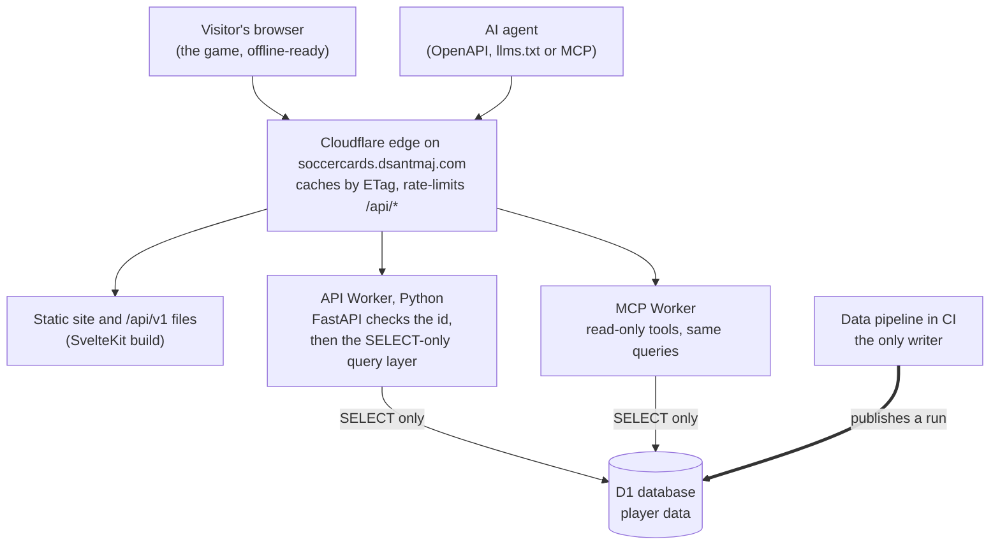

# The player API: why, what, how and the trade-offs

> Status: In review
> Created: 2026-11-21T20:55:39Z
> Last reviewed: 2026-11-21T20:55:39Z
> Next review: Not scheduled

## Review guide

Decision requested: confirm that this paper explains the API you approved in
ADR 0008 correctly, and say whether any trade-off changes your mind.

Check these points:

- [ ] The read-only, same-address design is worth what it rules out: nothing
      a visitor does can be saved on the server.
- [ ] Python on Cloudflare Workers is worth its costs against a TypeScript
      Worker (see [Trade-offs](#trade-offs)).
- [ ] The open questions at the end have the right owner.

Respond with `approve`, `approve with follow-up: <action>` or
`request changes: <specific issue>`.

## Summary

The player API is a read-only FastAPI app on a Cloudflare Python Worker. It
answers `/api/v2/*` on `soccercards.dsantmaj.com` from a Cloudflare D1
database that only the data pipeline writes. The database has its own paper,
[the player database](player-database.md).

You approved it as [ADR 0008](../decisions/0008-player-api-and-database.md)
on 2026-11-21. It exists so the game can hold thousands of professional
players instead of 24, and so AI agents can use the data through OpenAPI and
the Model Context Protocol (MCP). The static `v1` files keep working until
the site has moved to `v2`.

## Why

The static `v1` API can't grow to the player set you asked for. The pipeline
writes JSON files to `data/api/v1`, and the site serves them
([ADR 0005](../decisions/0005-api-and-schema-design.md) D8). The player list
is one file, capped at 1,000 players. It can't page, filter or sort.

Your goals on 2026-11-21 set the rest:

| Goal                                       | Your words                                                             | What it requires                                             |
| ------------------------------------------ | ---------------------------------------------------------------------- | ------------------------------------------------------------ |
| Every professional player worth collecting | "all players in the world", top leagues, national teams, the A-League  | Paging, filtering and squad lookups over thousands of rows   |
| A real database and API                    | "we do need to build a proper db and api"                              | A query layer, not files                                     |
| Usable by AI agents                        | "it needs to be the modern tht is AI agent appropriate"                | An OpenAPI description, an MCP server, stable ids and errors |
| The site looks the same                    | "the website still can be how it is"                                   | The same resources; the site moves screen by screen          |
| Built with FastAPI                         | "the API needs to be built using FAST API skill published by fast api" | Python, so a Python Worker                                   |
| Free forever                               | "yes its free and only my kid is using it"                             | Free tiers only, and a rate limit to protect them            |

Two rules from earlier records still hold. The site makes no request to
another host, and it collects no personal data
([ADR 0003](../decisions/0003-data-photos-and-child-privacy.md) D5). The API
design keeps both.

## What

`/api/v2` is a read-only resource API. It follows Google's API Improvement
Proposals (AIPs), as ADR 0005 already requires for `v1`.

| Method                                                               | Answers                           | AIP                                    |
| -------------------------------------------------------------------- | --------------------------------- | -------------------------------------- |
| `GET /api/v2/players`, `/clubs`, `/leagues`, `/national-teams`       | A page of a collection            | 132 (list), 158 (paging), 160 (filter) |
| `GET /api/v2/players/{player}`, and the same for each collection     | One resource                      | 131 (get)                              |
| `GET /api/v2/clubs/{club}/players`, `/national-teams/{team}/players` | A squad                           | 132 on a child collection              |
| `GET /api/v2/openapi.json`                                           | The machine-readable description  | OpenAPI 3.1                            |
| `GET /llms.txt`                                                      | A plain-text guide for AI agents  | None                                   |
| MCP Worker: `search_players`, `get_player`, `list_squad`, `get_club` | The same data as tools for agents | None                                   |

- **Names.** A resource is named like `players/lionel-messi`. The id has
  lowercase letters, digits and hyphens, starts with a letter, and never
  changes (ADR 0005 D2).
- **Paging.** `pageSize` and `pageToken` go in, and `nextPageToken` comes
  out. `filter` works on documented fields (`league`, `club`,
  `nationalTeam`, `tier`, `position`), and `orderBy` sorts. Every name is
  camelCase.
- **Errors.** One shape, from AIP-193:
  `{"error": {"code": 404, "message": "...", "status": "NOT_FOUND"}}`. A 500
  carries a fixed message and no internal detail.
- **Caching.** Every response has a strong `ETag` and `Cache-Control`. The
  Cloudflare edge and the site's service worker can keep it for offline
  play.
- **One contract.** A test checks every response model against the JSON
  Schemas in `packages/schema`. A program checks the OpenAPI file against the
  AIPs. A route that breaks either fails CI.

## How

Every request goes to the site's own address, and only the pipeline can
change the data.

A request for `/api/v2/players/lionel-messi` takes these steps:

1. The Cloudflare edge answers from its cache if the `ETag` still matches.
   If it doesn't, the edge passes the request to the API Worker.
2. FastAPI checks the id against ADR 0005 D2's pattern. A bad id, such as
   one with uppercase letters, `%2F` or `..`, gets a 400 before any query
   runs.
3. The query layer runs one constant `SELECT`, with the id as a bound
   parameter. It has no write method, and it refuses any statement that
   isn't a single `SELECT`. T-0135 built and tested this layer.
4. A missing row gives a 404. A database failure gives a 500 with a fixed
   message. The cause is never shown or logged.
5. The response model renames the fields to camelCase. The response goes
   back with its `ETag` and `Cache-Control`.

### The runtime

Cloudflare Python Workers run Python 3.13 on Pyodide, a WebAssembly build of
CPython. FastAPI runs through Cloudflare's ASGI adapter. D1 is a binding
that the Worker receives, not a network address. There is no server,
container or connection string to look after.

### The security floor

- The API is on the site's origin. The content security policy keeps
  `connect-src 'self'`, and no CORS header is needed.
- FastAPI's built-in OpenTelemetry is off, and Worker logs are off
  ([ADR 0002](../decisions/0002-hosting-and-infrastructure.md) D10). Nothing
  about a visitor is recorded.
- Packages come only from `apps/api/uv.lock`, and `no-build-package` refuses
  builds from source. OSV scans the lockfile in CI (T-0137).
- The database, the routes and the rate limit are OpenTofu resources. CI
  plans them, and only you apply them.

## Trade-offs

### What the design gives up

| Choice                   | Gain                                                                                   | Cost                                                                                                  |
| ------------------------ | -------------------------------------------------------------------------------------- | ----------------------------------------------------------------------------------------------------- |
| Read-only API            | No write path to attack, nothing to moderate, no personal data                         | No server-side progress, trading or play between devices. Each of those needs a new decision record   |
| Same address as the site | No new host for the security policy, no CORS, one certificate                          | The API and the site share one Cloudflare account, one zone and one set of quotas                     |
| Python with FastAPI      | Your choice. One language with the pipeline. FastAPI generates OpenAPI from its models | Python Workers are newer than JavaScript Workers and start more slowly. Packages must work on Pyodide |
| Edge caching by `ETag`   | Most requests never reach the Worker or the database, which protects the free quotas   | A new data run shows up only when caches expire or revalidate                                         |
| A separate MCP Worker    | Agents get tools without a custom client                                               | One more Worker to deploy and keep in step with the API                                               |

### Options considered and not chosen

- **Keep only static files and split them per league.** This is cheapest and
  safest. It still can't filter or search across leagues, and an agent would
  need many files to answer one question.
- **A TypeScript Worker with Hono.** It's more mature on Workers, starts
  faster, and shares types with `packages/schema` directly. You asked for
  FastAPI, and the pipeline is Python, so it wasn't chosen. It stays the
  fallback if the Python Worker can't meet the limits.
- **A server or a container host for FastAPI.** FastAPI is at home there.
  It adds a host outside Cloudflare, a bill, patching, and a second origin
  for the security policy.
- **A third-party sports API at run time.** A research task on 2026-11-22
  read the free tiers of Football-Data.org, API-Football and TheSportsDB.
  None was usable: they lack the A-League, the Australian national teams or
  women's football, or they forbid storing and republishing. A run-time
  call would also break the "no other host" rule.

## Risks and open items

- **The Python Worker is unproven here.** T-0136 runs FastAPI on the Workers
  runtime against a local D1 for the first time. It waits on a uv upgrade
  on your machine (`brew upgrade uv`, uv 0.13.4 or newer).
- **Free-plan limits aren't measured yet.** The Worker's CPU time per
  request, the D1 reads per day and the start-up time of a Python Worker
  need numbers from the spike before the rest is built.
- **`v1` and `v2` overlap.** Two versions run until the site no longer reads
  `v1` and you retire it (ADR 0008 D8).
- **OpenAPI drift.** The check of the OpenAPI file against the AIPs isn't
  built yet. Until then, a review is the only guard.

## What is built

| Task   | State                     | What it gives                                                              |
| ------ | ------------------------- | -------------------------------------------------------------------------- |
| T-0135 | Merged (PR 228)           | `apps/api` scaffold, the SELECT-only query layer, AIP-193 errors, 16 tests |
| T-0137 | Merged (PR 231)           | OSV scan and Dependabot updates for `apps/api/uv.lock`                     |
| T-0136 | Waiting on the uv upgrade | The first route on a real Python Worker with a local D1                    |
| T-0139 | Planned                   | Dependabot updates past the fixed uv date cut-off                          |

## Review history

| Reviewed at          | Decision | Notes                                                                                                                                                                                |
| -------------------- | -------- | ------------------------------------------------------------------------------------------------------------------------------------------------------------------------------------ |
| 2026-11-21T20:55:39Z | Drafted  | Written by Claude from ADRs 0002, 0003, 0005 and 0008 and the code in `apps/api`, at the tech lead's request ("i need a paper on ecah explaing the why how and what and tradeoffs"). |
