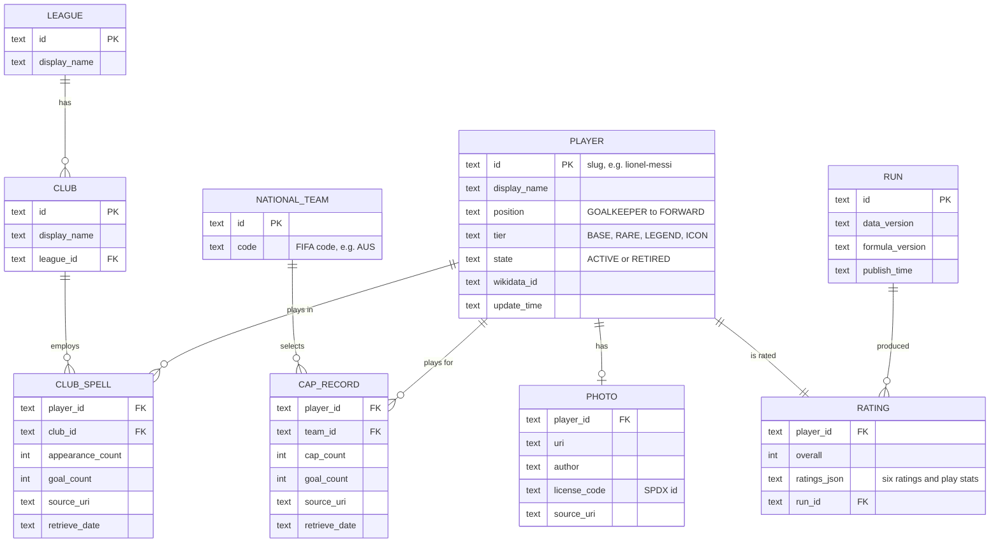
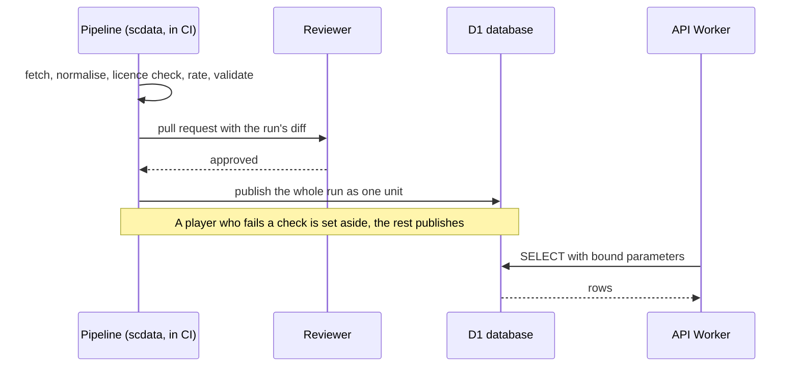

# The player database: why, what, how and the trade-offs

> Status: In review
> Created: 2026-11-21T20:55:39Z
> Last reviewed: 2026-11-21T20:55:39Z
> Next review: Not scheduled

## Review guide

Decision requested: confirm that this paper explains the database you
approved in ADR 0008 correctly, and approve or change the proposed tables
before the first migration beyond the spike is written.

Check these points:

- [ ] "Only the pipeline writes" is the rule you want, with no exception for
      an admin screen.
- [ ] The proposed tables in [What](#what) hold the data the cards need, and
      nothing about a person beyond the public record.
- [ ] The open items at the end, especially publishing a run as one unit,
      are acceptable to settle in the spike.

Respond with `approve`, `approve with follow-up: <action>` or
`request changes: <specific issue>`.

## Summary

The player data lives in one Cloudflare D1 database. D1 is a managed SQLite
database that a Worker reaches through a binding. The data pipeline is the
only writer, and it publishes a whole run at a time from CI. The API reads it
with `SELECT` statements only. See [the player API](player-api.md).

You approved this as
[ADR 0008](../decisions/0008-player-api-and-database.md) D1, D4 and D7 on
2026-11-21. The database holds public facts about professional players,
with each fact's source. It holds nothing about the children who play.

## Why

The game is moving from 24 players to thousands, and files stop working at
that size.

- **Questions files can't answer.** "Forwards in the A-League Women",
  "Western Sydney Wanderers' squad" or "every Icon" each need a filter or a
  join. With files, either the site downloads everything or the pipeline
  writes a file for every question.
- **A list that pages.** ADR 0005 caps the `v1` player list at 1,000
  players in one file. A query can return a page and a token for the next.
- **One place for a fact.** A player's club, goals and photo credit are
  stored once and read by the API, the MCP server and later screens alike.
- **A record of each run.** The pipeline already tracks a data version and
  a formula version. A table keeps them next to the data they produced.

The database doesn't replace the pipeline's review. A data change still
starts as a pipeline run that a person or a reviewer agent checks.

## What

D1 holds public, sourced facts about professional players with a Wikidata
item (ADR 0008 D6), and the project's own ratings for them.

| Stored                                                                         | Never stored                                                       |
| ------------------------------------------------------------------------------ | ------------------------------------------------------------------ |
| Names, positions, clubs, national teams, career years                          | Anything about a visitor: no accounts, progress, addresses or logs |
| Appearances, goals, caps and honours, each with `sourceUri` and `retrieveDate` | Amateur, community or youth players                                |
| The project's grades, ratings, tier and the formula version                    | Third-party ratings, club crests, league logos, card maker designs |
| Photo records: Commons page, author, licence (ADR 0003 D2)                     | The photo files themselves, which stay static assets               |

### Proposed tables

Only the spike's `players` table exists today (T-0136). The tables below are
a proposal for the next tasks, built from ADR 0005's resources. They are not
decided yet.

Column names are snake_case in SQL. The API's response models rename them
to camelCase, as ADR 0005 D4 requires. Ids are the same slugs as the
resource names, so a URL maps to a primary key with no lookup table.

## How

The pipeline writes the database, and the API only reads it.

1. **Build.** `scdata` runs its stages: fetch, normalise, licence check,
   rate, validate ([ADR 0006](../decisions/0006-data-pipeline-and-ratings.md)
   D5). Every stage but fetch is a pure function of files, and no test
   reaches the network.
2. **Review.** The run's output goes to a pull request, as it does for `v1`
   today.
3. **Publish.** A CI job writes the run to D1 with a Cloudflare token scoped
   to this one database (ADR 0008 D4, D7). The API never sees a half-written
   run.
4. **Read.** The API's query layer runs constant `SELECT` statements with
   bound parameters. It has no write method.

### Migrations and tests

- Each schema change is a numbered SQL file under `apps/api/migrations/`,
  applied with Wrangler's D1 migrations. T-0136 writes the first one.
- Tests load the same migration files into SQLite in memory, through a fake
  of the D1 binding. D1 is SQLite, so the SQL under test is the SQL that
  runs.
- Local development uses Wrangler's local D1, a SQLite file on disk, so no
  account or network is needed.

### Infrastructure

The D1 database is an OpenTofu resource in `infra/`. CI plans it, and you
apply it, as for every other resource
([ADR 0002](../decisions/0002-hosting-and-infrastructure.md) D3).

## Trade-offs

### What the design gives up

| Choice                                      | Gain                                                                          | Cost                                                                                                                  |
| ------------------------------------------- | ----------------------------------------------------------------------------- | --------------------------------------------------------------------------------------------------------------------- |
| D1 (managed SQLite)                         | Free tier, no server, same account and binding as the Worker, SQLite in tests | SQLite's features only: no stored procedures, a smaller SQL dialect than Postgres, size and query limits per database |
| One writer, the pipeline                    | No write path from the internet, every change reviewed                        | A fix to one player waits for a pipeline run and a pull request                                                       |
| Publish a whole run                         | Readers never see a mix of two runs                                           | A large run is one big write, which has to fit D1's limits                                                            |
| Ratings stored, not computed per request    | Fast reads, and the formula version is recorded                               | A formula change means a new run for every player                                                                     |
| Photos as static files, not in the database | Edge-cached, no database reads for images                                     | Two places to keep in step: the photo record and the file                                                             |

### Options considered and not chosen

- **Static JSON files only, one per league.** Simplest, and the
  [API paper](player-api.md) explains why it can't answer cross-league
  questions.
- **A hosted Postgres (Neon, Supabase).** Richer SQL and full-text search.
  It adds a host outside Cloudflare, a connection string to keep secret,
  and a free tier that can pause or change.
- **Workers KV.** Good for reading one key fast. It has no queries, so
  filters and squads would need hand-built indexes.
- **R2 object storage with JSON files.** Cheap and large. It has the same
  limits as static files, plus a second store to manage.

## Risks and open items

- **Publishing as one unit is unproven.** D1 runs each statement in a batch
  of statements together, which is the closest thing to a transaction a
  Worker gets. Whether a run of thousands of players fits in one batch, or
  needs a staging table and a switch, is for the spike to settle.
- **Free-plan limits aren't measured.** The database size, reads per day
  and rows read per query need numbers before the first full wave
  (ADR 0008 D6).
- **The proposed tables aren't decided.** They need your answer here and a
  task brief for each migration.
- **Wikidata gaps.** Appearance and goal counts are missing or stale for
  some players (ADR 0006). A missing fact is stored as absent, never as
  zero.
- **Backups.** D1 has point-in-time restore. The pipeline's committed output
  and its pull requests are the source of truth, so a lost database can be
  rebuilt from a run.

## Review history

| Reviewed at          | Decision | Notes                                                                                                                                                                                |
| -------------------- | -------- | ------------------------------------------------------------------------------------------------------------------------------------------------------------------------------------ |
| 2026-11-21T20:55:39Z | Drafted  | Written by Claude from ADRs 0002, 0005, 0006 and 0008, at the tech lead's request ("i need a paper on ecah explaing the why how and what and tradeoffs"). The tables are a proposal. |
